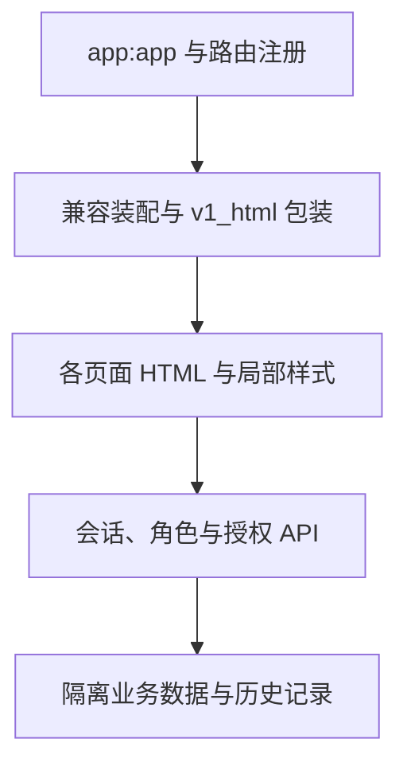

# 页面、渲染与业务依赖

盘点基于 `app:app` 生产入口、注册路由及各页面最终返回的 HTML。HTML 页面路由不等同于数据 API；动态内容与权限由现有业务接口决定。

| 页面族与入口 | HTML 入口及最终渲染 | 主要数据 API（页面所依赖的真实路由） | 角色和数据边界 | 关键回归 |
|---|---|---|---|---|
| 产品入口、独立工作台 `/`, `/new`, `/workbench`, `/start` | `changying/web/product_shell.py`; `app_v924.py:personal_start`; 兼容路由见 `changying/compat/legacy.py` | `/session`, `/start/summary`, `/teacher/dashboard` | 独立教师仅访问本人工作室；未登录 `/start` 显示空白步骤，不返回学生数据 | `tests/test_product_shell.py`, `tests/test_individual_workspace.py`, `tests/test_personal_start.py` |
| V1 登录、角色外壳、学生档案 `/v1*` | `changying/web/v1.py:v1_html` 经 legacy 补丁与 `gzip` 兼容桥装配；最终 HTML 按路径、身份和角色动态选择 DOM | `/session`, `/teacher/classes`, `/teacher/classes/{cid}/students`, `/teacher/students/{sid}/growth-profile`, `/teacher/dashboard` | 教师按学校与班级权限读取；学生与家长身份的读取范围由各业务接口限定；展示页不替代 API 鉴权 | `tests/test_v1_shell_router_contract.py`, `tests/test_v1_mobile_real_data_layout.py`, `tests/test_student_continuity.py`, `tests/test_role_permission_matrix.py` |
| 功能导航与 Classic `/v1/tool`, `/classic` | `v1_tool_hub.py`、`v1_unified_tools.py`、`v1_classic_gzip_embed.py`；保留现存 iframe 与 Classic 操作页面 | `/session`; Classic 使用原业务接口；跨页面会话交接按现有一次性授权接口进行 | 工具列表按当前教师、学生、家长、管理员角色过滤；嵌入页面仍走各 API 原有权限校验 | `tests/test_v1_classic_embed_bootstrap.py`, `tests/test_v1_cross_context_auth_handoff.py`, `tests/test_v1_unified_tools_session_bridge.py` |
| 晚托作业 `/v1/homework` | `homework_assistant.py:homework_page` → `homework_assistant_pages.py:homework_page_html` | `/homework/config`, `/teacher/homework/students`, `/teacher/homework/notices`, `/teacher/homework/parse`, `/teacher/homework/notices/{id}/publish`, `/student/homework/today`, `/student/homework/items/{notice_id}/{seq}/done` | 需启用 `HOMEWORK_ASSISTANT`; 教师创建与审核，学生读取本人任务并提交状态；求助另走作业求助 API | `tests/test_homework_teacher_help.py`, `tests/test_homework_help.py`, `tests/test_homework_guided_help.py`, `tests/test_homework_points_rule.py` |
| 周末备课与教师控制 `/v1/weekend-plan`, `/v1/weekend` | `weekend_plan_views.py`、`weekend_views.py` → `weekend_pages.py` | `/teacher/weekend/lessons`, `/teacher/weekend/sessions`, `/teacher/weekend/sessions/{sid}`, `/teacher/weekend/sessions/{sid}/next`, `/teacher/weekend/sessions/{sid}/slide`, `/teacher/weekend/sessions/{sid}/publish-answers` | 教师仅操作其有权课程/课堂；题目审核、顺序、答案可见由既有课程状态与权限控制 | `tests/test_weekend_import_integrity.py`, `tests/test_weekend_review_flow.py`, `tests/test_weekend_live_controls.py`, `tests/test_weekend_example_practice_separation.py` |
| 课堂大屏 `/v1/weekend-board`, `/v1/classroom-board/{sid}` | `weekend_views.py:board_page_html`; `v1_classroom_live_board.py:board_html` | `/teacher/weekend/sessions/{sid}/board`, `/teacher/classroom-sessions/{sid}/live-board`, `/teacher/classroom-sessions/{sid}/board-lock` | 投影读取当前课件与已公开内容；答案发布、遮挡/冻结需教师操作；页面重绘须保留滚动和焦点 | `tests/test_weekend_board_layout.py`, `tests/test_classroom_live_board.py`, `tests/test_classroom_board_lock.py` |
| 学生练习与家长报告 `/v1/weekend-practice`, `/v1/weekend-brief`, `/v1/weekend-report` | `weekend_practice.py`, `weekend_scoring_views.py`, `weekend_report_views.py` | `/student/weekend/current`, `/student/weekend/hint`, `/student/weekend/answer`, `/teacher/weekend/reports`, `/teacher/weekend/reports/{id}/publish` | 学生只提交本人答案；家长只读取绑定孩子已发布报告；教师编辑与发布权限保持原规则 | `tests/test_weekend_written.py`, `tests/test_weekend_reports.py`, `tests/test_weekend_feedback_upgrade.py`, `tests/test_guardian_visibility.py` |
| 课堂讲义 `/v1/classroom-review`, `/v1/classroom-handouts` | `v1_classroom_review.py`, `v1_classroom_handout_release.py` → 共享 V1 shell | `/teacher/assignments/{aid}/class-review/handout-releases`, `/teacher/assignments/{aid}/class-review/handout-publish`, `/teacher/assignments/{aid}/class-review/handout-revoke`, `/student/classroom-handouts`, `/student/classroom-handouts/{release_id}` | 教师按作业权限发布/撤回；学生仅读作为接收人的当前发布版本 | `tests/test_classroom_handout_release.py`, `tests/test_classroom_quick_check_phase_c.py` |
| 知识地图 `/v1/knowledge-map`, `/v1/my-knowledge-map` | `knowledge_map_views.py`, `knowledge_map_student.py`, 功能开关接线见 `legacy.py` | `/teacher/knowledge-maps`, `/teacher/knowledge-maps/{mid}/publish`, `/teacher/knowledge-maps/{mid}/classes/{cid}/reinforce`, `/student/knowledge-map`, `/student/knowledge-map/diagnosis/submit`, `/student/knowledge-map/nodes/{key}/quiz/submit` | 需启用 `KNOWLEDGE_MAP`; 教师发布/布置，学生提交本人诊断与练习 | `tests/test_knowledge_map_draft_note_ui.py`, `tests/test_v1_student_practice.py` |
| 应试专项 `/v1/exam-prep`, `/v1/exam-paper`, `/v1/exam-report` | `exam_prep_views.py` → `exam_prep_pages.py` | `/teacher/exam-goals`, `/teacher/exam-goals/{gid}/mock`, `/teacher/exam-reports/{rid}/publish`, `/student/exam-papers`, `/student/exam-papers/{aid}/start`, `/parent/children/{cid}/exam-reports` | 教师制定目标与发布；学生作答本人试卷；家长只读授权孩子已发布报告 | `tests/test_question_type_fit_and_quiz_navigation.py`, `tests/test_student_quiz_learning_points_ui.py`, `tests/test_guardian_visibility.py` |
| 家长账号、AI 设置与注册 `/parent-accounts`, `/teacher/ai-settings`, `/signup` | `app_v924.py` 内嵌 HTML 模板；当前只将展示层接入 `apply_surface` | `/teacher/classes`, `/teacher/parents`, `/admin/users`, `/teacher/students/{id}/parent`; `/teacher/ai-config`, `/teacher/ai-test`; `/signup/challenge`, `/signup` | 家长绑定只能由个人教师管理；AI Key 属于当前教师工作室；注册创建独立个人工作区 | `tests/test_personal_parent_accounts.py`, `tests/test_personal_ai_settings.py`, `tests/test_personal_signup.py` |
| 运营控制台 `/operator-console` | `app_v924.py:operator_console` 返回独立模板；待管理端阶段做最终 UI 处理 | `/operator/*`; 运营写接口继续依 `commercial_operator` 鉴权 | 运营密钥/管理员校验及学校范围保持原样；本轮不更改写操作 | `tests/test_operator_console_route.py` |
| 法律、离线及旧版别名 | `app_v924.py:legal_page`, `/offline`, 9 个 `/fresh-v*` 模板入口 | 无业务 API 或按原页面脚本加载；旧别名最终依赖同一旧版资源包 | 公开内容；旧版角色权限仍由原入口与 API 决定 | `tests/test_prelaunch_legal_readiness.py`, `tests/test_offline_page.py`, Safari 12 兼容测试 |

## 样式装配约束

`changying/web/design_system/apply_surface()` 只给原 HTML 根节点加 `data-cy-ui`，并注入有命名空间的 CSS；`CHANGYING_UI_REFRESH=0` 恢复旧样式。V1 多层包装、iframe 与旧版脚本顺序保留。样式开关不控制 API、数据或权限。

以上清单列主要读写端点，非完整 574 项 API 目录。未展开的题库、反馈和管理子操作须在对应页面阶段逐项核对源码与角色回归后再标记完成。
